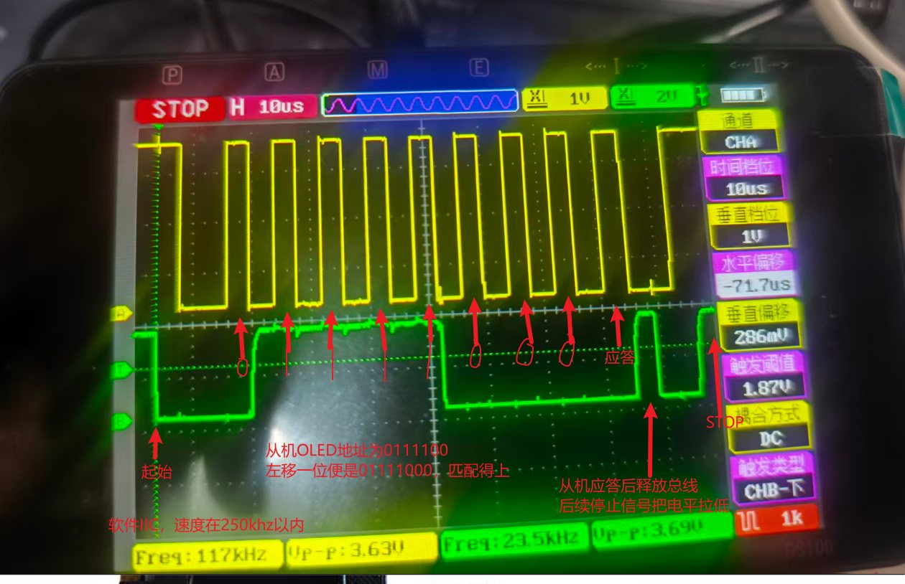
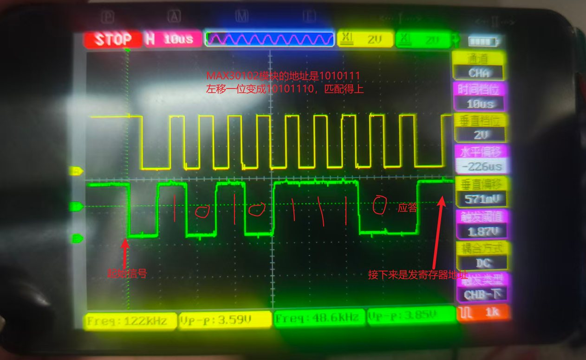
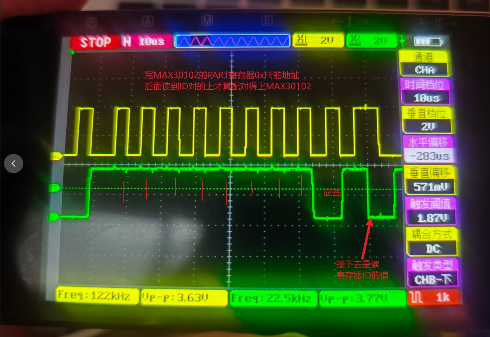
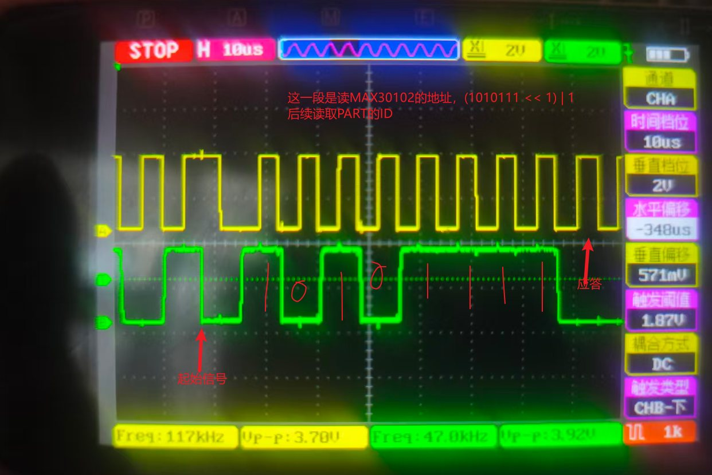
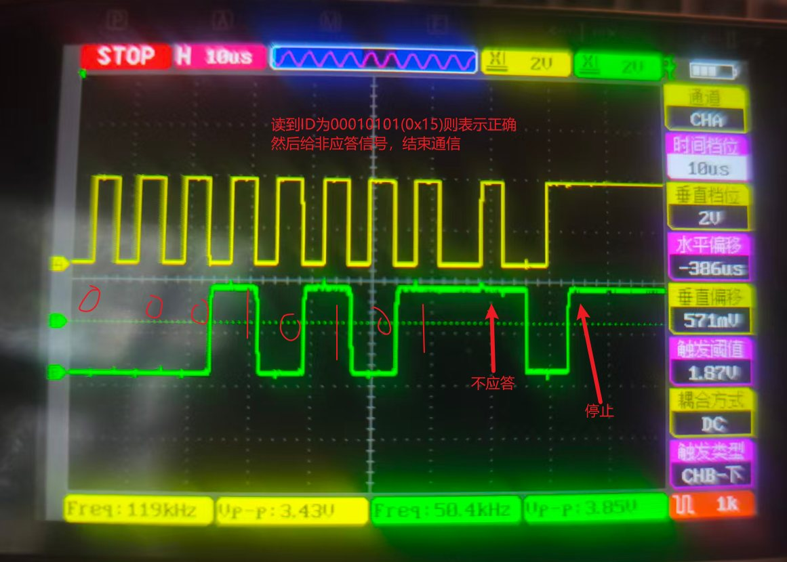
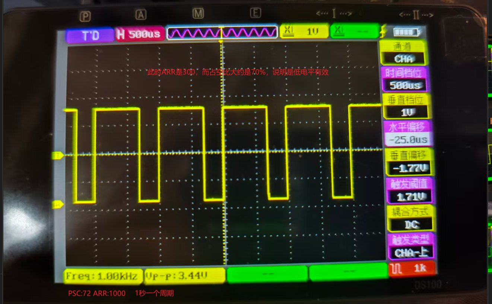
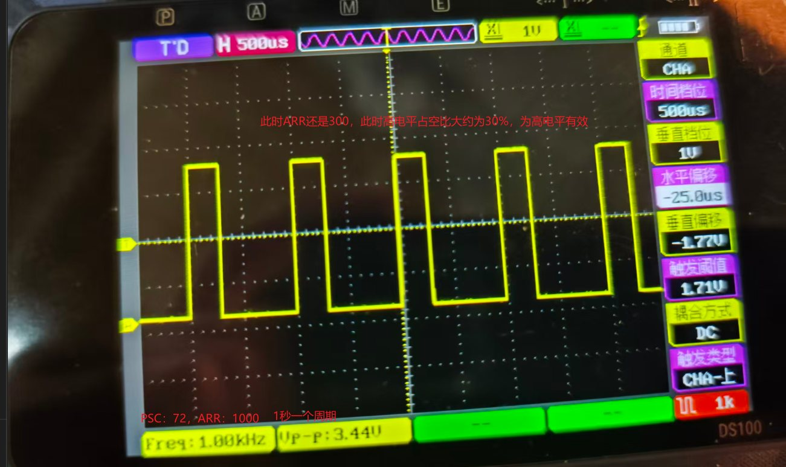
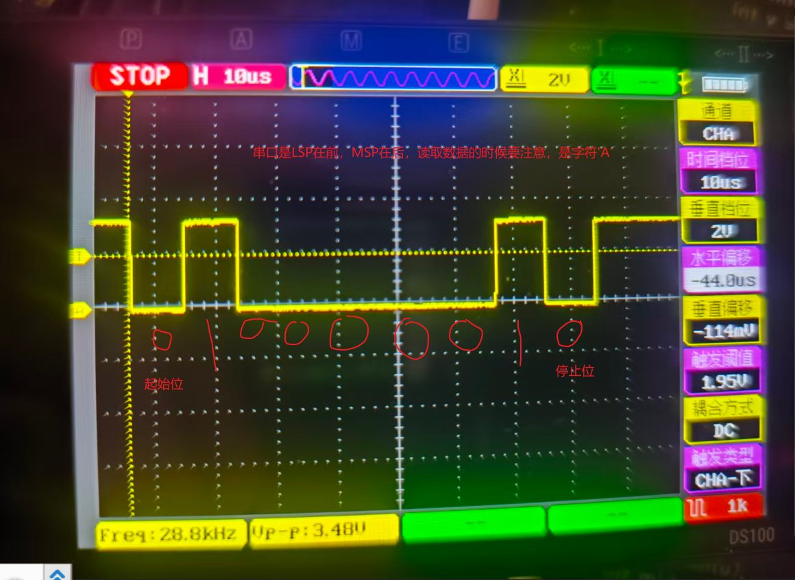
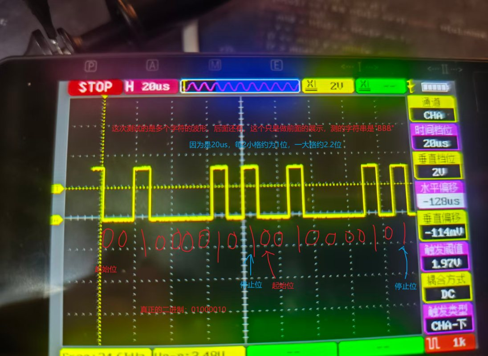

# STM32 智能环境监测终端

> 主控：**STM32F103ZET6**（ARM Cortex-M3，72 MHz）｜固件库：**STM32Cube HAL**｜开发环境：**Keil MDK-ARM**｜当前版本：**V1.3.3**

一个围绕「采集 — 显示 — 交互 — 存储」完整链路设计的嵌入式环境监测终端：3 路 ADC 模拟量采集、DHT11 温湿度检测、OLED 四页中文界面、串口命令行控制、PWM 调光、光照越限报警，并支持参数掉电保存与上电自动恢复。

📄 完整项目简介（Word 版）：[STM32智能环境监测终端-项目简介.docx](./docs/STM32智能环境监测终端-项目简介.docx)

---

## 一、功能特性

- **3 路 ADC 电压采集**：DMA 循环模式自动搬运，半传输 / 传输完成双中断标志实现前后台交替处理；软件**截尾均值滤波**（排序后剔除最大值、最小值），电压保留 3 位小数。
- **四页 OLED 中文界面**：电压页、控制值页、温湿度页、版本页，KEY0 / KEY1 按键循环翻页。
- **两级刷新机制**：切页时整屏静态绘制一次，运行中只刷新数值变化的行，减少屏幕闪烁与 I2C 总线开销。
- **串口命令行**：115200-8-N-1，DMA + 空闲中断实现不定长接收，支持一行内发送多条命令；任意一条无法识别即返回 `ERROR ORDER`。
- **PWM 调光**：TIM3_CH2 输出 PWM，0～999 共 1000 级占空比调节 LED0 亮度。
- **光照越限报警**：采集值超过设定阈值时自动点亮 LED1，回落到阈值以下后熄灭。
- **DHT11 温湿度检测**：定时读取并在第 3 页显示，传感器未接入时给出异常提示。
- **掉电参数保存**：阈值、PWM、页码写入 Flash 扇区 0，magic 标志（`0x5356`）+ 校验和双重校验，上电自动恢复。

## 二、硬件平台

| 类别 | 型号 / 说明 |
| --- | --- |
| 主控芯片 | STM32F103ZET6，Cortex-M3 内核，72 MHz，512 KB Flash / 64 KB SRAM |
| 开发板 | 正点原子 STM32F103 开发板 |
| 显示屏 | 0.96 寸 128×64 OLED（SSD1306 兼容，4 针 I2C，GPIO 软件模拟 I2C 驱动） |
| 传感器 | DHT11 温湿度传感器、光敏电阻、电位器 |
| 外部存储 | W25Q128 SPI Flash；驱动兼容 W25Q64 等型号，运行时读取 JEDEC ID 自动识别 |
| 指示与输入 | LED0（PWM 调光）、LED1（阈值报警）；3 个独立按键 |

## 三、引脚连接

| 外设 | 引脚 | 说明 |
| --- | --- | --- |
| USART1 | PA9 (TX) / PA10 (RX) | TX 使用 DMA1 通道 4；RX 使用 DMA1 通道 5 + 空闲中断 |
| ADC1 | PA1 / PA2 / PA3 | 通道 1 / 2 / 3，DMA1 通道 1，扫描 + 循环模式 |
| TIM3_CH2 | PB5 | PWM 输出，驱动 LED0 |
| LED1 | PE5 | 光照越限报警指示 |
| 按键 | KEY0=PE4，KEY1=PE3，KEY_UP=PA0 | KEY0 下一页，KEY1 上一页 |
| SPI2 | PB12(CS) / PB13(SCK) / PB14(MISO) / PB15(MOSI) | 外接 W25Q128（CS 由软件控制） |
| 软件 I2C | PB6(SCL) / PB7(SDA) | 开漏输出，连接 OLED |
| DHT11 | PG11 | 单总线温湿度传感器 |

## 四、串口命令说明

串口参数：波特率 **115200**，8 位数据位，无校验，1 位停止位。多条命令之间以空格分隔，可在同一行发送；只有全部命令执行成功才返回 `OK`，任意一条无法识别即返回 `ERROR ORDER`。

| 命令 | 功能 | 取值 / 说明 |
| --- | --- | --- |
| `READ_ADC` | 查询 3 路电压 | 返回 A / B / C 三路电压值，单位 V |
| `LED_ON` / `LED_OFF` | 点亮 / 熄灭 LED0 | LED0 由 TIM3_CH2 PWM 驱动 |
| `LIGHT:数值` | 设置光照报警阈值 | 范围 0～4095，默认 3000；数值越大越容易触发点亮 |
| `PWM:数值` | 设置 LED0 亮度 | 范围 0～999，数值越大越亮 |
| `PAGE:数值` | 直接跳转指定页面 | 范围 1～4，越界自动钳位到最大 / 最小页 |
| `SAVE` | 保存当前参数 | 将 LIGHT、PWM、PAGE 写入 Flash 扇区 0 |
| `LOAD` | 读取已保存参数 | 从 Flash 读出并通过串口回显 |

命令示例：

```text
LIGHT:3000 PWM:500 PAGE:2 SAVE
READ_ADC
```

## 五、工程结构

```text
环境采集监测终端/
├── Drivers/
│   ├── APP/                    # 应用层：页面状态机、命令业务、参数保存
│   ├── BSP/                    # 板级驱动：ADC / DHT11 / OLED / Flash / SPI ...
│   ├── SYSTEM/                 # sys / delay / usart 基础组件
│   ├── CMSIS/                  # ARM CMSIS 标准文件
│   └── STM32F1xx_HAL_Driver/   # ST 官方 HAL 库
├── Users/                      # main.c、中断服务、HAL 配置
├── Projects/MDK-ARM/           # Keil 工程（atk_f103.uvprojx）
└── archive/                    # 1.1.0 ~ 1.3.3 历次版本代码快照
```

### BSP 板级驱动层

| 模块 | 主要职责 |
| --- | --- |
| `adc.c` | ADC1 三通道初始化、DMA 缓冲管理、截尾均值滤波与电压换算 |
| `dma.c` | ADC 与 USART1 所用 DMA 通道的统一初始化 |
| `cmd.c` | 命令行解析：表驱动命令匹配，LIGHT / PWM / PAGE 键值解析与边界钳位 |
| `pwm.c` | TIM3_CH2 PWM 初始化与占空比设置 |
| `btim.c` | 基本定时器初始化，提供定时基准 |
| `led.c` / `key.c` | LED 初始化与亮度控制；3 个按键扫描 |
| `myiic.c` | GPIO 软件模拟 I2C（开漏输出，不占用硬件 I2C 外设） |
| `bsp_i2c_oled.c` / `fonts.c` | OLED 显示原语（8×16 字符、16×16 汉字、清屏）与取模字库 |
| `spi.c` / `norflash.c` | SPI2 收发；W25Qxx 读、写、擦除、ID 识别封装（应用仅使用扇区 0） |
| `dht11.c` | DHT11 单总线时序、温湿度读取与数据校验 |

### APP 应用层

| 模块 | 主要职责 |
| --- | --- |
| `app_page_switch` | 页面切换状态机：按键翻页，静态整屏绘制 + 动态数值刷新两级调度 |
| `app_voltage_oled` | 第 1 页：3 路电压的标签绘制与数值刷新 |
| `app_control_data_oled` | 第 2 页：光照阈值与 PWM 占空比显示 |
| `app_dht11_oled` | 第 3 页：温湿度定时刷新，未检测到传感器时提示 |
| `app_version_page` | 第 4 页：项目名称与固件版本号 |
| `app_save` | 掉电数据结构体、Flash 存取、magic 标志与校验和判定 |

## 六、软件设计要点

1. **表驱动命令解析**：命令名与处理函数以「结构体数组」注册表形式管理，新增命令只需增加一行表项；解析器自动按空格切分 token、按冒号分离键值，未注册命令一律拒绝。
2. **页面状态机 + 局部刷新**：以 `current_page` 与「切页标志」管理两级动作——切页时整屏重绘，平时只刷新数值；按键翻页与 `PAGE` 串口命令共用同一套跳转入口。
3. **DMA 全链路无阻塞**：串口接收使用 DMA + 空闲中断处理不定长数据，发送使用 DMA 环形队列；ADC 循环采集通过半传输 / 完成双中断标志在后台交替处理两半缓冲。
4. **掉电数据可靠性设计**：16 字节存储结构体以固定 magic（`0x5356`）标识数据有效性，配合校验和识别空片（全 `0xFF`）与损坏数据，异常时自动回退默认参数。

## 七、快速开始

1. 使用 Keil MDK-ARM 打开 `Projects/MDK-ARM/atk_f103.uvprojx`；
2. 编译工程，下载到 STM32F103ZET6 开发板；
3. 使用 USB 转串口连接 USART1（PA9/PA10），打开串口助手（115200，换行发送）；
4. 发送 `READ_ADC`、`PWM:500`、`PAGE:2` 等命令进行交互；
5. 按 KEY0 / KEY1 切换 OLED 页面，发送 `SAVE` 保存当前参数后断电重启验证恢复效果。

## 八、示波器实测波形

以下为实际使用示波器对本项目外设总线与输出信号的抓取记录，图中中文标注为测量时对时序的分析说明（图片已压缩，[docs/images](./docs/images) 下为仓库版本）。

### I2C 总线（软件 I2C 驱动 OLED / MAX30102）

| 说明 | 波形 |
| --- | --- |
| OLED：起始信号、从机地址 0111100 匹配、从机应答与停止信号 |  |
| MAX30102：起始信号与写地址 |  |
| MAX30102：写寄存器 PART 地址 |  |
| MAX30102：写地址后读 PART ID |  |
| MAX30102：读到器件 ID |  |

### PWM 输出

| 说明 | 波形 |
| --- | --- |
| 低电平有效实测 |  |
| 高电平有效实测 |  |

### 串口（USART1 115200）

| 说明 | 波形 |
| --- | --- |
| 发送字符 'A'：标注起始位 / 数据位（LSB 在前）/ 停止位 |  |
| 多字符连续发送波形 |  |

## 九、版本迭代记录

| 版本 | 更新内容 |
| --- | --- |
| 1.1.0 | 新增 PAGE 翻页命令，完善串口命令提示 |
| 1.2.0 | 新增 SAVE / LOAD 命令，阈值、PWM、页码支持掉电保存与读取 |
| 1.2.1 | 优化 3 路电压多通道显示排版 |
| 1.3.1 | 新增 DHT11 温湿度模块与第 3 页显示 |
| 1.3.2 | 新增 LED1 阈值报警；命令严格校验，任意一条错误即返回 ERROR ORDER |
| 1.3.3 | 串口打印改为 DMA 发送并引入环形队列；命令表数量随表项自适应；ADC 改为循环模式 + 半传输 / 完成双中断处理 |

历次版本代码快照见 [`archive/`](./archive) 目录。

## 十、版权与出处声明

1. `Drivers/CMSIS` 与 `Drivers/STM32F1xx_HAL_Driver` 目录下的代码为 **STMicroelectronics** 官方提供的 CMSIS 与 STM32F1 HAL 库，版权归 STMicroelectronics 所有，许可条款以各目录内自带的 LICENSE.txt 为准。
2. `Drivers/SYSTEM`（delay / sys / usart）基于**正点原子** STM32F103 教学例程修改，版权归正点原子所有，本项目仅用于个人学习交流。
3. `Drivers/APP` 与 `Drivers/BSP` 下的应用层代码与业务驱动为本人在学习过程中编写实现。
4. 本项目为个人学习与求职作品展示用途，不用于任何商业目的。
